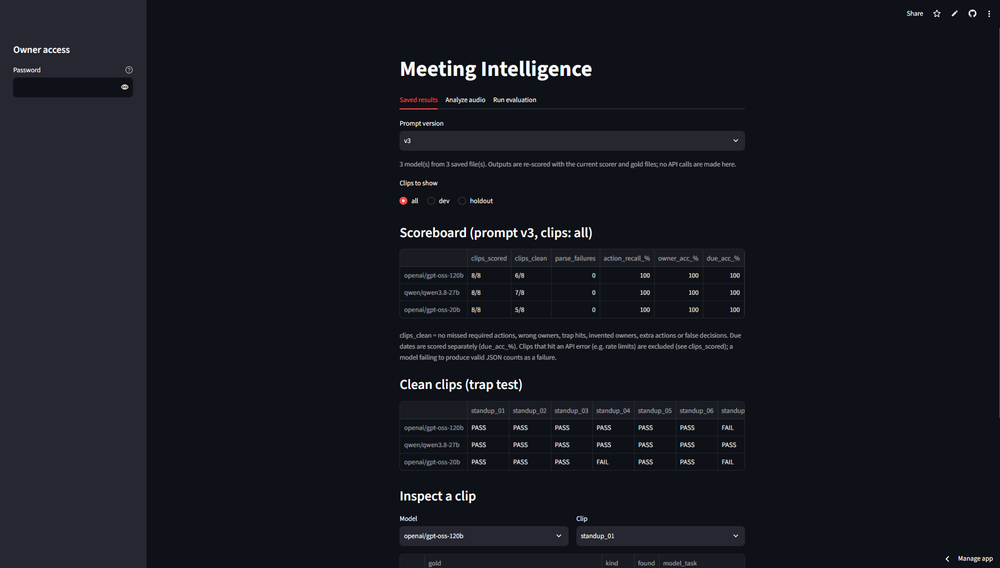

# Meeting Intelligence with Evals

Turns a meeting recording or transcript into structured JSON: summary, decisions, action items (owner, due date, supporting quote) and open questions. It also includes an **evaluation harness** that scores any model against a hand-labeled test set, so you can see *how* a model fails instead of trusting a demo.

**Live demo:** https://www.loom.com/share/4b9ba7177618468fa7fc0a92d365a695 (free hosting: the first load can take ~30 seconds, and it shares a free API quota, so rate-limit errors are possible)

(https://github.com/pc1817/meeting-intel/blob/main/scoreboard.png?raw=true

## Why this project)

Most meeting summarizers are shown with one good example. This one is built around the question "when does it get it wrong?": it separates real commitments from tentative ideas, reversed decisions, unassigned work ("we should…") and unresolved topics, and measures each failure type per model and per prompt version.

## How it works

```
audio ──► Whisper (Groq) ──► transcript ──► LLM (Groq, JSON output) ──► structured result
                                                         │
                           hand-labeled gold files ──► scoring.py ──► scoreboard
```

- **Transcription:** `whisper-large-v3-turbo` via the Groq API.
- **Extraction:** any chat model available on Groq. Output must follow a fixed JSON schema, and every decision and action carries an `evidence_quote`.
- **Grounding check:** each quote is matched against the transcript (normalized, fuzzy) to catch invented content.
- **UI:** Streamlit, with two tabs: *Analyze audio* (one recording) and *Evaluate models* (the benchmark).

Everything runs in the cloud on free tiers; nothing runs locally except the web UI during development.

## Results

Clean clips out of 8 (a clip is clean when it has no missed actions, wrong owners, trap hits, invented owners, extra actions or false decisions):

| Model | Prompt v2 | Prompt v3 |
|---|---|---|
| gpt-oss-120b | 4/8 | 6/8 |
| gpt-oss-20b | 6/8 | 5/8 |
| qwen3.8-27b | 3/8 | 7/8 |

### Baseline: prompt v2, 5 dev clips

| Model | Clips clean | Action recall | Owner accuracy | Due-date accuracy | Trap hits | False decisions |
|---|---|---|---|---|---|---|
| gpt-oss-20b | 4/5 | 88.9% | 100% | 87.5% | 0 | 1 |
| gpt-oss-120b | 3/5 | 88.9% | 100% | 87.5% | 0 | 2 |
| qwen3.8-27b | 2/5 | 88.9% | 100% | 87.5% | 1 | 1 |

### Prompt v3 vs v2

| Clean clips | Prompt v2 | Prompt v3 |
|---|---|---|
| Dev (5 clips × 3 models) | 9/15 | 14/15 |
| Hold-out (3 clips × 3 models) | 4/9 | 4/9 |

| Model | Dev v2 → v3 | Hold-out v2 → v3 |
|---|---|---|
| gpt-oss-120b | 3/5 → 5/5 | 1/3 → 1/3 |
| gpt-oss-20b | 4/5 → 4/5 | 2/3 → 1/3 |
| qwen3.8-27b | 2/5 → 5/5 | 1/3 → 2/3 |

| Hold-out clip | v2 | v3 |
|---|---|---|
| `standup_06` reversed decision | 2/3 | 3/3 |
| `standup_07` "we should…" later deferred | 2/3 | 1/3 |
| `standup_08` tentative suggestion (contested label) | 0/3 | 0/3 |

Prompt v3 raised clean clips on the dev clips from 9/15 to 14/15, but the hold-out clips (written separately, not used for tuning) stayed flat at 4/9. The "final decision only" and "copy the timing words" rules generalized; the rule "a concrete 'we should…' task with no owner is an action" did not: on `standup_07`, where the same phrasing was later deferred, both gpt-oss models turned a deferred suggestion into an action. Dev gains partly reflect fitting the prompt to known failures.

## Findings

- **The failures are classification errors, not invention.** Across all 6 runs (3 models × 2 prompts × 8 clips), every quote was grounded in the transcript, every output matched the schema, and owner accuracy on required actions was 100%. What went wrong was what counted as a decision or an action.
- **The ranking flipped between prompts.** Under v2 the order was gpt-oss-20b (6/8), gpt-oss-120b (4/8), qwen3.8-27b (3/8); under v3 it was qwen3.8-27b (7/8), gpt-oss-120b (6/8), gpt-oss-20b (5/8). Explicit written rules helped the models that had failed on implicit conventions. With 8 clips this is a hypothesis, not a conclusion.
- **A larger model was not better under v2.** gpt-oss-20b beat gpt-oss-120b on the dev clips (4/5 vs 3/5) in two separate runs.
- **One rule helped and hurt.** Prompt v3 says a concrete "we should…" task with no owner is an action. That fixed `standup_04` but broke `standup_07`, where the transcript later defers the same kind of suggestion.
- **Timing words generalized.** Telling the model to copy stated timing words ("next meeting", "this afternoon") raised hold-out due-date accuracy for both gpt-oss models from 75% to 100%.
- **Models turn conversational "let's" into a personal assignment.** In the speaker-labeled hold-out dialogue, gpt-oss-20b on v3 assigned "Let's…" statements to whoever spoke them (owner "Marcus" on two group intentions in `standup_08`) and filed Ella's commitment as a decision as well.
- **Every model disagreed with one label.** All models, under both prompts, filed "Let's gather a few examples … before changing anything" (`standup_08`) as a decision. I kept the gold unchanged and report that clip as contested.

## Test set

| Split | Clips | Format |
|---|---|---|
| dev | `standup_01` to `standup_05` | short narrated standups |
| holdout | `standup_06` to `standup_08` | speaker-labeled dialogue, different wording |

Each clip targets one failure mode: baseline, tentative suggestion, reversed decision, ambiguous owner ("we should…"), discussed-but-not-committed, "we should…" later deferred, tentative idea.

- The transcripts are **synthetic**: drafted or generated with ChatGPT or Claude, then checked by me.
- The gold labels were drafted with AI assistance (ChatGPT's expected results for the hold-out clips; Claude's labels for all 8 clips) and checked by me.
- The prompt (v3) was written after seeing failures on the dev clips. The hold-out clips were written separately and were **not** used to tune v3.
- The hold-out clips are speaker-labeled dialogue while the dev clips are narrated, so a hold-out drop could come from the format change as well as from overfitting.

This is a small adversarial suite, not a statistical sample. Read results as "how models behave on these traps", not "model X is better".

## How scoring works

Scoring is deterministic (no LLM judge) and lives in `scoring.py`.

- **Matching:** each gold action or decision is matched one-to-one to a model item by word overlap (threshold 0.5) on the task text plus its supporting quote.
- **Owner:** must match the gold owner. If the gold says nobody was assigned, the model must not invent an owner; "team", "the team" and "we" count as no owner.
- **Due date:** scored separately (`due_acc_%`) from the clean/fail verdict.
- **Trap hit:** the model extracted something the gold lists as `not_actions`.
- **False decision:** a decision that is not in the gold (including superseded ones).
- **Clean clip:** no missed required actions, wrong owners, trap hits, invented owners, extra actions or false decisions.
- **API errors** (e.g. rate limits) are excluded from scores and reported as `ERROR`. A model failing to produce valid JSON counts as a failure.

The *Inspect a clip* view shows exactly how every gold item was matched, so any verdict can be checked by hand.

### Gold labeling rules

1. A named person committing to or being assigned a task is a required action with that owner.
2. A concrete task with no named person ("We should send the report by Friday") is an action with a null owner, **unless the transcript later defers it** ("let's decide how to handle it next time"), in which case it is not an action.
3. Ideas that are only being considered, discussed or tentatively suggested are not actions or decisions.
4. A group intention with no owner ("let's review the open items at standup") is `optional`: not penalized if absent, but an invented owner counts as an error.
5. When a decision is reversed, only the final decision counts.
6. If the transcript says no decision was made, there are no decisions.

Judgment calls: `standup_04` and `standup_07` both follow rule 2 above (the deferral exception); "activities will continue as usual" in `standup_05` is not counted as a decision; "gather examples first" in `standup_08` is not counted as a decision (contested).

## Design notes

| Component | Choice |
|---|---|
| Identity | A meeting-analyst system prompt: extract only what was said, never infer owners (versioned in `prompts.py`) |
| Goals | Faithfulness over completeness; measured by trap hits, false decisions, owner accuracy |
| Context | One transcript per call |
| Memory | None across meetings (deliberate; single-meeting analysis) |
| Tools | Groq API (Whisper + chat models), Streamlit |
| Planning | Fixed pipeline, not an agent (deliberate) |
| Triggers | A button in the UI |
| Feedback loops | JSON retry/parse fallback, 429 retry, eval-driven prompt versions |
| Observability | Results JSON with model, prompt version, latency, tokens and every per-item verdict |
| Human approval | The output is for review; nothing is sent anywhere automatically |

## What went wrong along the way

- My first grounding check used an exact substring match and flagged false positives on punctuation and curly apostrophes. I replaced it with normalized fuzzy matching.
- The scorer could never mark a required "no owner" action correct.
- "The team" was wrongly flagged as an invented owner.
- API rate-limit errors were counted as model failures.
- A model failing to produce valid JSON was first treated like an API error and excluded, which flattered that model. It now counts as a failure.
- Early runs changed the prompt and the checker at the same time, which made the comparison unfair. Prompts are now versioned and compared one change at a time.
- An early weak-model run (allam-2-7b) used prompt v1 and was dropped from the comparison.

## Limitations

- Small hand-labeled suite; labels involve judgment calls (documented above).
- Word-overlap matching can mismatch paraphrases; use the inspect view to verify verdicts.
- Open questions are displayed but not scored.
- Audio-to-text accuracy is not evaluated: the benchmark runs on text transcripts.
- Results are one run per model and prompt at temperature 0. The same model and prompt gave the same verdicts across two runs, but I would not call it deterministic.
- Free-tier rate limits apply, and the public demo has no usage cap.
- Model IDs are recorded in each results file; hosted models can change or be retired.
- `standup_08`'s gold is contested: every model, under both prompts, labels "Let's gather a few examples … before changing anything" as a decision, while the gold says there are none. I kept the gold unchanged (relabeling after seeing results would be tuning) and report the clip as contested.
- One gpt-oss-20b run on prompt v3 failed on `standup_08` with a JSON-generation error; a rerun with the same settings completed without error. The cause is unknown.

## Data and privacy

Use only synthetic or public transcripts. Free-tier API providers may log prompts, so do not upload real or confidential meetings.

## Run it yourself

1. Create a free key at [console.groq.com](https://console.groq.com).
2. Deploy on [Streamlit Community Cloud](https://share.streamlit.io) from this repo, entrypoint `app.py`.
3. Add the key under **Settings → Secrets**: `GROQ_API_KEY = "gsk_..."`. Never commit the key.

Results are saved with the **Download results** button and committed under `data/results/`.

## Repository layout

```
app.py            Streamlit app (Analyze audio + Evaluate models)
scoring.py        deterministic scoring and matching
prompts.py        versioned system prompts (v2, v3)
requirements.txt  streamlit, groq
data/
  transcripts/    standup_01.txt ... standup_08.txt
  gold/           standup_01.json ... standup_08.json
  results/        downloaded results per model and prompt version
docs/             screenshots used in this README
```

## Roadmap

- Score open questions.
- Evaluate end to end with real audio (Whisper errors on names).
- Resolve "we" from the previous sentence when it names specific people, with its own hold-out clip.
- Add more clips and a second labeler.
